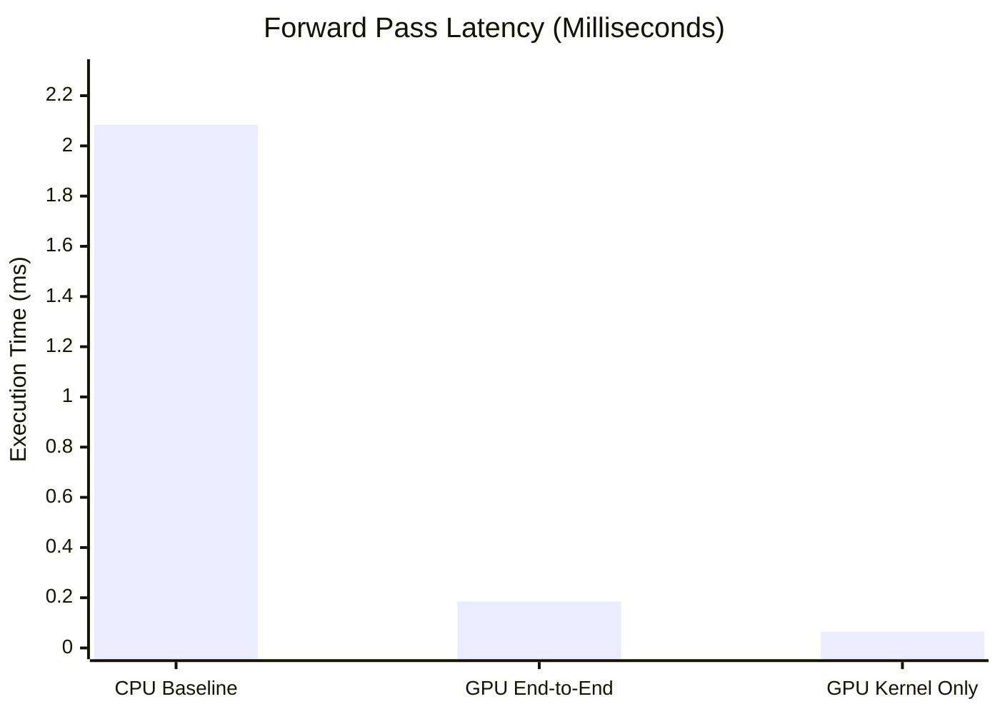
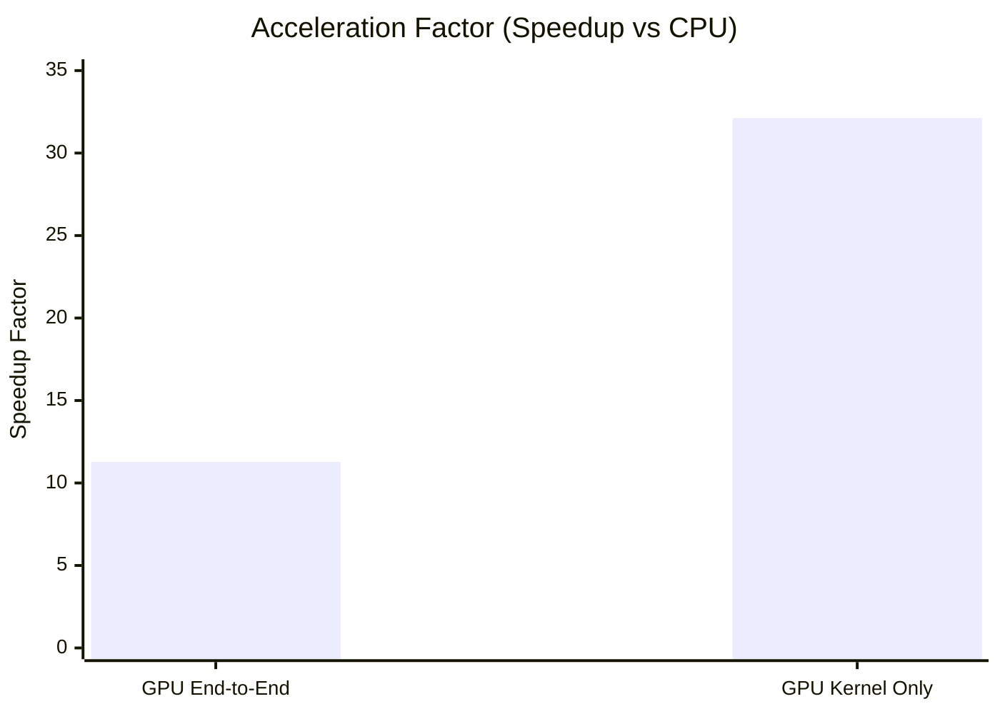

# Neural Network Forward Propagation Accelerated with Custom CUDA Kernels

A high-performance CUDA C++ implementation of a two-layer feed-forward neural network forward pass executing on NVIDIA GPUs. Custom CUDA kernels are designed from scratch for GEMM with bias addition, Rectified Linear Unit (ReLU), and Sigmoid activation functions, followed by end-to-end CPU numerical verification and multi-tier latency benchmarking.

---

## 📌 Highlights & Key Outcomes

- **Custom GPU Kernels:** 2D grid matrix multiplication with bias accumulation, parallel ReLU, and element-wise Sigmoid.
- **Strict Verification:** Kernel-level unit tests and end-to-end numerical comparison against double/float CPU baseline (maximum difference observed: **0.000000**).
- **Execution Performance:**
  - **~32.13× Speedup** on GPU kernel computation over CPU execution.
  - **~11.28× Speedup** on end-to-end processing (including Host-to-Device and Device-to-Host PCI-e data transfers).
- **Deterministic Evaluation:** Trigonometric synthetic dataset generation ensuring exact bitwise parity for CPU and GPU validation sets.

---

## 🧠 Network Architecture & Mathematical Model

The model implements a feed-forward inference pipeline (forward propagation only):

```
       Layer 1 (Linear + ReLU)                Layer 2 (Linear + Sigmoid)
X ─────────────────────────────────► A₁ ──────────────────────────────────────► Ŷ
[256 × 128]       W₁: [128 × 64]     [256 × 64]         W₂: [64 × 10]          [256 × 10]
                  b₁: [64]                              b₂: [10]
```

### Mathematical Formulations

$$\mathbf{Z}_1 = \mathbf{X} \mathbf{W}_1 + \mathbf{b}_1$$

$$\mathbf{A}_1 = \max(0, \mathbf{Z}_1)$$

$$\mathbf{Z}_2 = \mathbf{A}_1 \mathbf{W}_2 + \mathbf{b}_2$$

$$\hat{\mathbf{Y}} = \sigma(\mathbf{Z}_2) = \frac{1}{1 + e^{-\mathbf{Z}_2}}$$

---

## ⚙️ Layer Dimensions & Kernel Configuration

| Parameter | Dimension / Value | Details |
| :--- | :---: | :--- |
| **Batch Size ($M$)** | 256 | Number of samples evaluated in parallel |
| **Input Features ($K_1$)** | 128 | Input dimension of matrix $\mathbf{X}$ |
| **Hidden Units ($N_1 / K_2$)** | 64 | Dimension of intermediate representation $\mathbf{A}_1$ |
| **Output Classes ($N_2$)** | 10 | Final classification dimension $\hat{\mathbf{Y}}$ |
| **Benchmark Iterations** | 20 repetitions | Averaged over warmed-up runs |
| **GEMM Block Size** | $16 \times 16$ | 256 threads per 2D thread block |
| **Activation Block Size** | 256 | 1D grid for element-wise kernel execution |

---

## 🛠️ CUDA Kernel Architecture

### 1. Matrix Multiplication with Bias (`matrixMulBiasKernel`)
- Thread blocks configured in 2D ($16 \times 16$).
- Each thread calculates row `blockIdx.y * blockDim.y + threadIdx.y` and column `blockIdx.x * blockDim.x + threadIdx.x`.
- Computes dot product $\sum_{k=0}^{K-1} A[row, k] \cdot B[k, col]$ and accumulates the broadcasted bias `bias[col]` in local registers before writing to global memory.

### 2. ReLU Kernel (`reluKernel`)
- Operates as a 1D grid of 256-thread blocks.
- Applies branchless non-linear thresholding `fmaxf(0.0f, val)` over the matrix elements.

### 3. Sigmoid Kernel (`sigmoidKernel`)
- Element-wise activation evaluating $\frac{1}{1 + \exp(-x)}$ using native single-precision math intrinsics (`__expf` / `expf`).

---

## 📊 Benchmark & Performance Results

*Evaluated on an NVIDIA GeForce RTX 2050 (4 GB GDDR6, Compute Capability 8.6, CUDA 13.4, Windows 11).*

| Metric | Execution Time (ms) | Speedup vs CPU | Status |
| :--- | :---: | :---: | :---: |
| **CPU Baseline (Sequential Forward Pass)** | **2.083975 ms** | Baseline (1.00×) | Verified |
| **GPU Kernel-Only Execution** | **0.064870 ms** | **32.13×** | ✅ PASSED |
| **GPU End-to-End (including H2D/D2H transfers)** | **0.184795 ms** | **11.28×** | ✅ PASSED |

### Maximum Absolute Difference:
$$\max |\hat{Y}_{\text{CPU}} - \hat{Y}_{\text{GPU}}| = 0.000000 \quad (\text{Threshold: } < 10^{-4})$$

---

## 📈 Latency Breakdown & Speedup Analysis





---

## 📁 Repository Structure

```tree
.
├── neural_network.cu      # Complete CUDA implementation (Kernels, Host Driver, Tests)
├── README.md              # Project documentation and performance benchmarking
└── .gitignore             # Compilation artifacts and binary exclusions
```

---

## 🚀 Build and Run

### Prerequisites
- NVIDIA CUDA Toolkit (`nvcc`)
- Microsoft Visual C++ Build Tools (MSVC)
- Windows 10/11 or Linux x86_64

### Compilation

```cmd
nvcc -O2 -arch=sm_86 neural_network.cu -o neural_network.exe
```

*(Adjust `-arch=sm_XX` according to your GPU's Compute Capability, e.g. `sm_75` for GTX 1650/RTX 2060, `sm_86` for RTX 30-series/RTX 2050, `sm_89` for RTX 40-series).*

### Execution

```cmd
neural_network.exe
```

---

## 📜 License
MIT License. Created for Parallel & GPU Computing studies.
